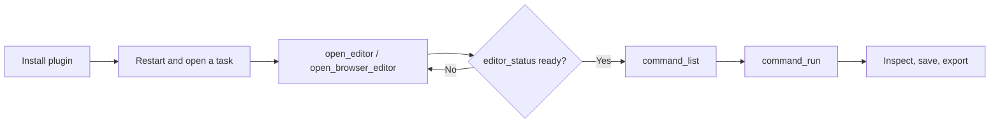

# VectorCraft Use

## Plugin marketplaces

This plugin belongs to **AIGC content creation**.

| Category | Marketplace | Purpose |
| --- | --- | --- |
| Full-stack development | [Full Stack Plugins](https://github.com/partme-ai/full-stack-plugins) | Architecture and UI design, code understanding, quality checks, code review, workflow governance, and server operations |
| AIGC content creation | [Full AIGC Plugins](https://github.com/partme-ai/full-aigc-plugins) | Image, video, audio, music, 3D, and multimodal content creation |


> Turn a brand brief into an editable native VectorCraft project — logo, icon set, infographic or chart — and revise it object by object instead of re-drawing it.

[](https://github.com/full-aigc-plugins/vectorcraft-plugin/releases)
[](#skills)
[](#mcp-tools)
[](LICENSE)

[English](README.md) | [简体中文](README.zh-CN.md) · [Install](#installation) · [Quick start](#quick-start) · [Skills](#skills) · [Troubleshooting](#troubleshooting)

## Positioning

`vectorcraft` connects a coding agent to the real VectorCraft engine, so a task ends with a native `.vectorcraft` project you can reopen and keep editing, not just a flattened picture. The plugin owns workflow skills, a pinned first-use CLI installer, and a same-session editor bridge; it does not re-implement the editor, the renderer, or the file format.

| Property | Value |
| :--- | :--- |
| Plugin ID | `vectorcraft` |
| Version | `0.1.0-dev.20261018.2` |
| Status | Development preview; full domain and all-host acceptance still open |
| Editor runtime | Node.js 24, started from `ui/bootstrap.mjs` |
| Native CLI | `vectorcraft-cli` maintained build `0.2.0-craft.2`, derived from upstream `v0.2.0` |
| Verified CLI platform | macOS arm64 with Python 3.11 or newer |
| License | Apache-2.0 |

Current plugin: `0.1.0-dev.20261019.1`; skill source: `0.1.0-dev.47`; version roles are independent.

| Identity | Current value |
| --- | --- |
| Metadata version | 0.1.0-dev.20261019.1 |
| Skills source | vectorcraft-skills / 0.1.0-dev.47 |


## Installation

### Prerequisites

- Node.js 24 on `PATH`. The bundled stdio MCP server runs on it (`package.json` pins `>=24 <25`).
- For the CLI skills: macOS arm64 and Python 3.11 or newer. The first use installs the pinned `vectorcraft-cli` into your user data directory; nothing is written to `PATH` and `sudo` is not used.
- Network access on the first editor launch. The plugin downloads and verifies the pinned editor archive; a complete release ZIP already contains it, and no Rust toolchain or `npm install` is needed.

### From the plugin marketplace

```bash
codex plugin marketplace add partme-ai/full-aigc-plugins
codex plugin add vectorcraft@full-aigc-plugins
```

Restart the host, open a new task, and ask VectorCraft to open the editor for your workspace.

### Other host manifests

| Host | Manifest | Path base |
| --- | --- | --- |
| Standard Agent Plugins 1.0.0 | `plugin.json`, `mcp.json` | `${PLUGIN_ROOT}` |
| Codex | `.codex-plugin/plugin.json`, `.codex-plugin/mcp.json` | plugin root relative to `cwd` |
| Claude Code | `.claude-plugin/plugin.json`, `.mcp.json` | `${CLAUDE_PLUGIN_ROOT}` |

Kimi loads the same skill set through `kimi.plugin.json`. The plugin does not guess absolute paths. In a development checkout you must build the editor assets first; cloning the source is not an installed runtime.

## Quick start



1. Open the editor with an explicit `workspace` argument — the folder holding your files, not the plugin folder.
2. Wait for `editor_status` before editing; instructions sent earlier act on an unattached page.
3. Read `command_list` (or `list_commands` for the shorter panel catalogue), then act with `command_run` / `command_batch`.
4. Save the native project, close it, and reopen it to confirm the objects are still editable.
5. Export only what you verified; the native file stays the source of truth.

For the CLI path, the skills run the pinned binary through the bundled harness:

```bash
python3 -I -B skills/vectorcraft-harness/scripts/cli.py -- --version
python3 -I -B skills/vectorcraft-harness/scripts/cli.py -- commands
```

Both commands prove installation and discovery only; they are not creative acceptance.

## What you can build

| Workflow | Built-in path | Verifiable output |
| :--- | :--- | :--- |
| Logo system with mono and reversed variants | `vectorcraft-logo-system`, `vectorcraft-cli-artboards` | Native artboards, one per variant, with distinct IDs |
| Consistent icon set | `vectorcraft-icon-set`, `vectorcraft-cli-shapes` | Icons on named artboards, editable paths |
| Infographic for a process or dataset | `vectorcraft-infographic`, `vectorcraft-editable-chart` | Live text and `create_graph` charts, not baked images |
| Trace a bitmap back to vectors | `vectorcraft-trace-artwork`, `vectorcraft-cli-paths` | Rebuilt paths plus the original as a reference layer |
| Clipped illustration and sticker sheets | `vectorcraft-clipped-illustration`, `vectorcraft-sticker-grid`, `vectorcraft-sticker-offset-border` | Releasable clipping groups, resizable arrays, offset outlines |
| Recolor a brand without touching neighbours | `vectorcraft-cli-appearance`, `vectorcraft-cli-selection` | Changed bound variants, unchanged unrelated objects |
| Multi-artboard delivery | `vectorcraft-cli-export` + `export` tool | SVG, PDF, raster or template output per artboard range |

The plugin never rewrites the upstream editor and never silently changes a deliverable format. Rasterized effects are reported instead of being hidden.

## Skills

| Skill | What it does |
| :--- | :--- |
| `vectorcraft-use` | Main entry: routes a request to the narrowest skill and keeps the native project as the deliverable |
| `vectorcraft-harness` | Shared execution channel: pinned CLI bootstrap, command gateway, workflow and desktop session scripts |
| `vectorcraft-cli` | Command catalogue, argv contract, selection by attribute and bounded rework |
| `vectorcraft-cli-setup` | First install, digest check, version check and broken-runtime diagnosis |
| `vectorcraft-cli-project` | Create, reopen and save projects; layer organisation; document colour mode |
| `vectorcraft-cli-shapes` | Compose shapes, reflect, shear, align, distribute and change object bounds |
| `vectorcraft-cli-paths` | Edit anchors and handles; outline, offset, simplify and clean paths |
| `vectorcraft-cli-selection` | Select by attribute, lock, hide, isolate and limit the edit scope |
| `vectorcraft-cli-appearance` | Brand colours, fill, stroke, transparency and appearance variants |
| `vectorcraft-cli-boolean` | Pathfinder, compound paths and shape-builder operations |
| `vectorcraft-cli-text` | Logo and brand text, font dependencies and outlined export |
| `vectorcraft-cli-artboards` | Multi-artboard logo/icon layouts and size variants |
| `vectorcraft-cli-assets` | Place assets, manage links and symbols, trace existing images |
| `vectorcraft-cli-export` | Vector exchange formats, previews and multi-artboard asset bundles |
| `vectorcraft-editor` | Open the real editor in the host, bind the workspace, mirror agent actions on the page |
| `vectorcraft-logo-system` | Vector logos, monochrome and reversed variants |
| `vectorcraft-icon-set` | One visual style across a set of vector icons |
| `vectorcraft-infographic` | Process, structure and data-explanation graphics |
| `vectorcraft-trace-artwork` | Bitmap-to-vector reconstruction for marks and line art |
| `vectorcraft-editable-chart` | Charts that stay editable inside a report |
| `vectorcraft-svg-cleanup` | SVG size, path and compatibility clean-up before delivery |
| `vectorcraft-clipped-illustration` | Releasable clipping-mask illustration |
| `vectorcraft-sticker-grid` | Sticker arrays with adjustable rows and columns |
| `vectorcraft-sticker-offset-border` | Offset white outline that keeps the original artwork intact |
| `vectorcraft-scenario-playbooks` | Step-by-step CLI/MCP recipes with parameters and save-reopen checks |

Skills are committed from an independent `vectorcraft-skills` source and pinned by `skills.lock.json` (source repo, commit, whole-skill digests). They ship scenario knowledge and entry contracts, not a second engine.

## MCP tools

One bundled server, `vectorcraft-editor`, speaking **stdio**; the local HTTP listener only serves the editor page and its same-session bridge. The catalogue exposes 40 tools: 35 agent-callable tools and 5 `_editor_*` bridge tools the panel uses internally. `list_commands` and `run_command` are the shorter panel aliases of `command_list` and `command_run`.

| Family | Tools | Purpose |
| :--- | :--- | :--- |
| Session | `open_editor`, `open_browser_editor`, `editor_status` | Open the editor and confirm that it attached to this MCP session |
| Command gateway | `command_list`, `command_run`, `command_batch` | Discover engine commands and run one or many with JSON params |
| Document inspection | `doc_inspect` / `inspect_document`, `render_preview`, `screenshot` | Layer tree, artboards, selection, history; render an artboard to PNG (`window:true` captures the window, desktop app) |
| Interface | `ui_inspect` / `inspect_ui`, `ui_screenshot` | Panels, dialogs and zoom state; window capture in the desktop app |
| Authoring | `draw_path`, `draw_shape`, `add_text`, `set_paint`, `transform`, `apply_effect`, `pathfinder`, `create_graph`, `text_wrap` | Create and modify editable objects, return their IDs |
| Interaction | `select_tool`, `pointer_gesture`, `press_key`, `type_text`, `invoke_menu`, `open_panel` | Drive the same paths a mouse and keyboard would; `type_text`, `open_panel` and `window.*` menus need the desktop app |
| Files | `open_file`, `save_file`, `export` | Open, save and export in the engine's own formats |
| History | `undo`, `redo` | Step back and forward one change |

A batch step may reference an earlier result (`"$1.id"`, `"$last.id"`); `command_batch` stops on the first error and is capped at 256 steps.

## Configuration

| Setting | Where | Effect |
| :--- | :--- | :--- |
| `workspace` argument | `open_editor` / `open_browser_editor` | Binds the task folder; paths outside it are refused |
| `CRAFT_EDITOR_UPDATE=off` | stdio MCP `env` | Use the bundled editor only; no download attempt |
| `CRAFT_EDITOR_CACHE_DIR` | Environment | Absolute directory for verified editor archives |
| `--runtime-home` | Harness CLI | Isolate the pinned runtime cache for a task |

Claude Code reads `CRAFT_PANEL_METADATA_FILE` from `.mcp.json` for panel metadata. Verified editor archives are cached under `~/.cache/full-aigc/editors`. An active session keeps its version until it is closed; a corrupt cache falls back to the bundled build and is not deleted automatically.

## Architecture and security

Agent ↔ plugin traffic is stdio MCP. The browser bridge listens on `127.0.0.1` only, with a random token and Host/Origin checks; workspace escapes are rejected, downloads are verified by SHA-256 before use, and the bundled editor is always kept as a fallback. Skills are instructions and do not enforce policy at runtime. The plugin stores no account or API credential, and the authors do not receive MCP traffic. Reference documents: [editor integration](docs/editor-integration.md), [runtime architecture](docs/VectorCraft-Runtime-Architecture.md), [documentation index](docs/README.md), [OpenSpec change](openspec/changes/establish-v1-plugin/proposal.md).

## Troubleshooting

| Symptom | Action |
| :--- | :--- |
| Editor tools are missing | Confirm the plugin is enabled, restart the host, open a new task |
| The panel does not render inside the host | The host lacks MCP Apps or a built-in browser; use the URL from `open_browser_editor` |
| First open stalls | The first launch needs the pinned archive; retry once with network, or set `CRAFT_EDITOR_UPDATE=off` |
| CLI install fails | Check macOS arm64, Python 3.11+, free disk space and the recorded digest; the installer never upgrades silently |
| A write times out | Reopen or inspect the project before retrying; do not replay a possibly applied edit |
| Windows Git installation breaks paths | `git config --global core.longpaths true`, or install from the release ZIP |

## Upgrade

```bash
codex plugin marketplace upgrade full-aigc-plugins
codex plugin add vectorcraft@full-aigc-plugins
```

Skill and runtime identities are pinned per release; upgrading the plugin does not upgrade the CLI in place.

## Contributing and support

Open issues at <https://github.com/full-aigc-plugins/vectorcraft-plugin/issues>. Behaviour changes start in `openspec/changes/establish-v1-plugin/specs/`; a task is checked only after real acceptance. Read `AGENTS.md` before editing skills or manifests, and keep Chinese and English documents aligned.

## License

Original repository content is [Apache-2.0](LICENSE). The icon is upstream VectorCraft artwork under MIT, recorded in `assets/official-icon-source.json`. Upstream VectorCraft is a separate project at <https://github.com/storytold/vectorcraft>; this plugin is an integration, not an endorsement, and its licences apply separately.
