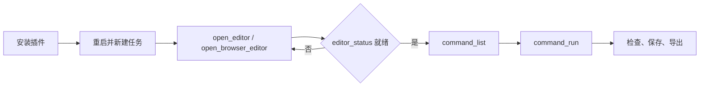

# VectorCraft Use

## 插件市场导航

本插件所属分类：**AIGC 内容创作**。

| 分类 | 插件市场入口 | 用途 |
| --- | --- | --- |
| 全栈开发 | [Full Stack Plugins](https://github.com/partme-ai/full-stack-plugins) | 架构与 UI 设计、代码理解、质量检查、代码审查、流程治理与服务器运维 |
| AIGC 内容创作 | [Full AIGC Plugins](https://github.com/partme-ai/full-aigc-plugins) | 图像、视频、音频、音乐、3D 与多模态内容创作 |


> 把品牌需求变成可继续编辑的原生 VectorCraft 工程——标志、图标集、信息图或图表——并按对象局部返工，而不是重新画一遍。

[](https://github.com/full-aigc-plugins/vectorcraft-plugin/releases)
[](#技能)
[](#mcp-工具)
[](LICENSE)

[English](README.md) | [简体中文](README.zh-CN.md) · [安装](#安装) · [快速开始](#快速开始) · [技能](#技能) · [故障排查](#故障排查)

## 项目定位

`vectorcraft` 把编码智能体接到真实的 VectorCraft 引擎上，因此任务结果是可重开、可继续编辑的原生 `.vectorcraft` 工程，而不是一张压平的图片。插件负责工作流技能、锁定版本的首次安装器和同会话编辑器桥接；它不重新实现编辑器、渲染器或文件格式。

| 属性 | 取值 |
| :--- | :--- |
| 插件 ID | `vectorcraft` |
| 版本 | `0.1.0-dev.20261018.2` |
| 状态 | 开发预览；完整领域验收与全部宿主验收仍未完成 |
| 编辑器运行时 | Node.js 24，由 `ui/bootstrap.mjs` 启动 |
| 原生 CLI | 维护版 `vectorcraft-cli` `0.2.0-craft.2`，基于上游 `v0.2.0` |
| 已核验 CLI 平台 | macOS arm64，Python 3.11 或更新版本 |
| 许可证 | Apache-2.0 |

当前插件：`0.1.0-dev.20261019.1`；技能源：`0.1.0-dev.47`；插件与技能保持独立版本。

| Identity | Current value |
| --- | --- |
| Metadata version | 0.1.0-dev.20261019.1 |
| Skills source | vectorcraft-skills / 0.1.0-dev.47 |


## 安装

### 前置条件

- `PATH` 上有 Node.js 24。内置 stdio MCP server 依赖它运行（`package.json` 声明 `>=24 <25`）。
- 使用 CLI 类技能需要 macOS arm64 与 Python 3.11 或更新版本。首次使用会把锁定版 `vectorcraft-cli` 安装到用户数据目录，不修改 `PATH`，也不使用 `sudo`。
- 首次打开编辑器需要网络：插件会下载并校验锁定编辑器制品；完整发行 ZIP 已内置该制品，因此无需 Rust 工具链，也无需 `npm install`。

### 从插件市场安装

```bash
codex plugin marketplace add partme-ai/full-aigc-plugins
codex plugin add vectorcraft@full-aigc-plugins
```

重启宿主，新建任务，然后让 VectorCraft 为你的工作区打开编辑器。

### 其他宿主清单

| 宿主 | 清单 | 路径基准 |
| --- | --- | --- |
| 标准 Agent Plugins 1.0.0 | `plugin.json`、`mcp.json` | `${PLUGIN_ROOT}` |
| Codex | `.codex-plugin/plugin.json`、`.codex-plugin/mcp.json` | 相对 `cwd` 的插件根目录 |
| Claude Code | `.claude-plugin/plugin.json`、`.mcp.json` | `${CLAUDE_PLUGIN_ROOT}` |

Kimi 通过 `kimi.plugin.json` 加载同一套技能。插件不猜测绝对路径；在开发仓中必须先构建编辑器资源，只克隆源码不等于已安装运行包。

## 快速开始



1. 打开编辑器时显式传入 `workspace`，指向你要交付的文件所在目录，而不是插件安装目录。
2. 等待 `editor_status` 就绪后再编辑；提前发出的指令作用在尚未接入的页面上。
3. 先读 `command_list`（面板简版目录用 `list_commands`），再用 `command_run` / `command_batch` 执行。
4. 保存原生工程后关闭并重开，确认对象仍然可编辑。
5. 只导出已核验的内容；原生文件始终是事实源。

CLI 路径通过内置 harness 运行锁定二进制：

```bash
python3 -I -B skills/vectorcraft-harness/scripts/cli.py -- --version
python3 -I -B skills/vectorcraft-harness/scripts/cli.py -- commands
```

这两条命令只证明安装与命令发现，不代表创作任务已完成。

## 可完成的工作

| 工作流 | 内置路径 | 可验证输出 |
| :--- | :--- | :--- |
| 含单色版与反白版的标志系统 | `vectorcraft-logo-system`、`vectorcraft-cli-artboards` | 每个变体一个原生画板，ID 稳定 |
| 统一图标集 | `vectorcraft-icon-set`、`vectorcraft-cli-shapes` | 命名画板上的矢量图标，路径可编辑 |
| 流程或数据说明信息图 | `vectorcraft-infographic`、`vectorcraft-editable-chart` | 活文字与 `create_graph` 图表，不是烘焙图片 |
| 位图回溯为矢量 | `vectorcraft-trace-artwork`、`vectorcraft-cli-paths` | 重建路径，原图保留为参考层 |
| 裁切插画与贴纸阵列 | `vectorcraft-clipped-illustration`、`vectorcraft-sticker-grid`、`vectorcraft-sticker-offset-border` | 可释放裁切组、可调行列阵列、白边轮廓 |
| 换品牌色而不影响相邻对象 | `vectorcraft-cli-appearance`、`vectorcraft-cli-selection` | 绑定变体已更新，无关对象保持不变 |
| 多画板交付 | `vectorcraft-cli-export` + `export` 工具 | 按画板范围输出 SVG、PDF、位图或模板 |

插件不重写上游编辑器，也不私自更改交付格式；被栅格化的效果会如实报告，而不是隐藏。

## 技能

| 技能 | 作用 |
| :--- | :--- |
| `vectorcraft-use` | 主入口：把请求路由到最窄的技能，并保持原生工程作为交付物 |
| `vectorcraft-harness` | 统一执行通道：锁定 CLI 引导、命令网关、工作流与桌面会话脚本 |
| `vectorcraft-cli` | 命令目录、argv 契约、按属性选择与有界返工 |
| `vectorcraft-cli-setup` | 首次安装、摘要校验、版本检查与运行时损坏诊断 |
| `vectorcraft-cli-project` | 建立、重开与保存工程；图层组织；文档色彩模式 |
| `vectorcraft-cli-shapes` | 组合形状、反射、斜切、对齐、分布与对象边界 |
| `vectorcraft-cli-paths` | 编辑锚点与控制柄；轮廓化、偏移、简化与清理路径 |
| `vectorcraft-cli-selection` | 按属性选择、锁定、隐藏、隔离并限定修改范围 |
| `vectorcraft-cli-appearance` | 品牌色、填充描边、透明度与外观变体 |
| `vectorcraft-cli-boolean` | Pathfinder、复合路径与形状构建操作 |
| `vectorcraft-cli-text` | 标志与品牌文字、字体依赖与导出轮廓 |
| `vectorcraft-cli-artboards` | Logo 与图标的多画板布局及尺寸变体 |
| `vectorcraft-cli-assets` | 放置素材、管理链接与符号、描摹已有图像 |
| `vectorcraft-cli-export` | 矢量交换格式、预览与多画板资产包 |
| `vectorcraft-editor` | 在宿主内打开真实编辑器、绑定工作区、把 Agent 操作映射到同一页面 |
| `vectorcraft-logo-system` | 矢量标志、单色版与反白版 |
| `vectorcraft-icon-set` | 同一视觉风格的矢量图标集 |
| `vectorcraft-infographic` | 流程、结构与数据说明图 |
| `vectorcraft-trace-artwork` | 标识与线稿的位图转矢量重建 |
| `vectorcraft-editable-chart` | 报告里仍然可编辑的图表 |
| `vectorcraft-svg-cleanup` | 交付前的 SVG 尺寸、路径与兼容性整理 |
| `vectorcraft-clipped-illustration` | 可释放裁切蒙版的插画 |
| `vectorcraft-sticker-grid` | 行列可调的贴纸阵列 |
| `vectorcraft-sticker-offset-border` | 保留原稿的白边轮廓 |
| `vectorcraft-scenario-playbooks` | 带参数与保存重开检查的分步 CLI/MCP 手册 |

技能来自独立的 `vectorcraft-skills` 源，并由 `skills.lock.json` 固定来源仓库、提交与整技能摘要。它们提供场景知识和入口契约，不是第二套引擎。

## MCP 工具

只内置一个 server：`vectorcraft-editor`，使用 **stdio**；本地 HTTP 只承载编辑器页面与同会话桥接。目录共 40 个工具，其中 35 个可供 Agent 调用，5 个 `_editor_*` 是面板内部使用的桥接工具。`list_commands` 与 `run_command` 是 `command_list` 与 `command_run` 的面板简版别名。

| 类别 | 工具 | 用途 |
| :--- | :--- | :--- |
| 会话 | `open_editor`、`open_browser_editor`、`editor_status` | 打开编辑器并确认已接入当前 MCP 会话 |
| 命令网关 | `command_list`、`command_run`、`command_batch` | 查询引擎命令，用 JSON 参数执行单条或多条 |
| 文档检查 | `doc_inspect` / `inspect_document`、`render_preview`、`screenshot` | 图层树、画板、选择与历史；把画板渲染为 PNG（`window:true` 时截窗口，仅桌面应用） |
| 界面 | `ui_inspect` / `inspect_ui`、`ui_screenshot` | 面板、对话框与缩放状态；桌面应用可截窗口 |
| 创作 | `draw_path`、`draw_shape`、`add_text`、`set_paint`、`transform`、`apply_effect`、`pathfinder`、`create_graph`、`text_wrap` | 建立与修改可编辑对象，返回对象 ID |
| 交互 | `select_tool`、`pointer_gesture`、`press_key`、`type_text`、`invoke_menu`、`open_panel` | 走与鼠标键盘相同的执行路径；`type_text`、`open_panel` 与 `window.*` 菜单需要桌面应用 |
| 文件 | `open_file`、`save_file`、`export` | 用引擎自有格式打开、保存与导出 |
| 历史 | `undo`、`redo` | 前进与回退一步变更 |

批处理步骤可以引用前面的结果（`"$1.id"`、`"$last.id"`）；`command_batch` 遇到首个错误即停止，上限 256 步。

## 配置

| 配置 | 位置 | 作用 |
| :--- | :--- | :--- |
| `workspace` 参数 | `open_editor` / `open_browser_editor` | 绑定任务目录；越界路径会被拒绝 |
| `CRAFT_EDITOR_UPDATE=off` | stdio MCP 的 `env` | 只用内置编辑器，不再尝试下载 |
| `CRAFT_EDITOR_CACHE_DIR` | 环境变量 | 已校验编辑器归档的绝对缓存目录 |
| `--runtime-home` | Harness CLI | 为单个任务隔离锁定运行时缓存 |

Claude Code 从 `.mcp.json` 读取 `CRAFT_PANEL_METADATA_FILE` 作为面板元数据。已校验的编辑器归档缓存在 `~/.cache/full-aigc/editors`；活动会话在关闭前保持自己的版本，缓存损坏时回退内置版本且不会自动删除。

## 架构与安全

Agent 与插件之间只走 stdio MCP。浏览器桥接只监听 `127.0.0.1`，使用随机令牌并校验 Host/Origin；工作区之外的路径被拒绝，下载内容使用前按 SHA-256 校验，内置编辑器始终保留为回退。技能只是指令，不在运行时强制执行策略。插件不保存账号或 API 凭据，作者不接收 MCP 流量。参考文档：[编辑器接入](docs/editor-integration.md)、[运行时架构](docs/VectorCraft-Runtime-Architecture.zh_CN.md)、[文档索引](docs/README.zh-CN.md)、[OpenSpec 变更](openspec/changes/establish-v1-plugin/proposal.md)。

## 故障排查

| 现象 | 处理 |
| :--- | :--- |
| 看不到编辑器工具 | 确认插件已启用，重启宿主，新建任务 |
| 宿主内不渲染面板 | 宿主缺少 MCP Apps 或内置浏览器；改用 `open_browser_editor` 返回的地址 |
| 首次打开卡住 | 首次需要下载锁定归档；联网重试一次，或设置 `CRAFT_EDITOR_UPDATE=off` |
| CLI 安装失败 | 检查 macOS arm64、Python 3.11+、磁盘空间与回执中的摘要；安装器不会静默升级 |
| 写入超时 | 先重开或检查工程，再决定是否重试；不要重放可能已生效的编辑 |
| Windows 下 Git 安装路径异常 | 执行 `git config --global core.longpaths true`，或改用发行 ZIP |

## 升级

```bash
codex plugin marketplace upgrade full-aigc-plugins
codex plugin add vectorcraft@full-aigc-plugins
```

技能与运行时身份按发行固定；升级插件不会原地升级 CLI。

## 贡献与支持

问题请提交到 <https://github.com/full-aigc-plugins/vectorcraft-plugin/issues>。行为变更先在 `openspec/changes/establish-v1-plugin/specs/` 立规格，任务只有在真实验收后才勾选。修改技能或清单前先读 `AGENTS.md`，并保持中英文文档一致。

## 许可证

本仓原创内容采用 [Apache-2.0](LICENSE)。图标为 MIT 许可的上游 VectorCraft 素材，来源记录在 `assets/official-icon-source.json`。上游 VectorCraft 是独立项目 <https://github.com/storytold/vectorcraft>；本插件是集成，不构成背书，双方许可证分别适用。
